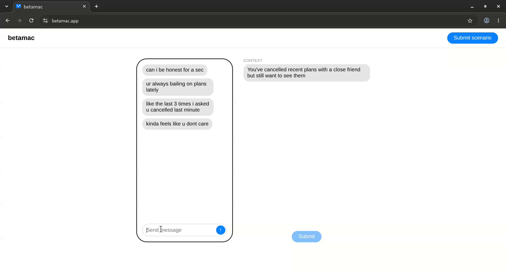
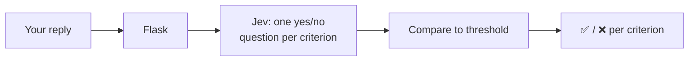
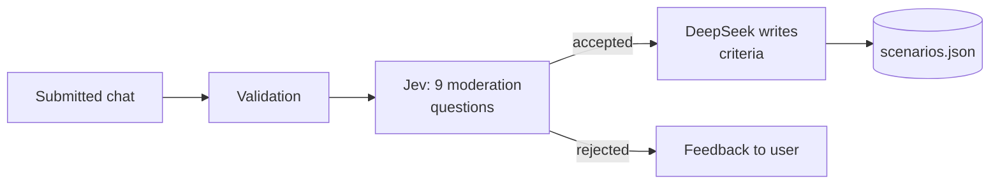
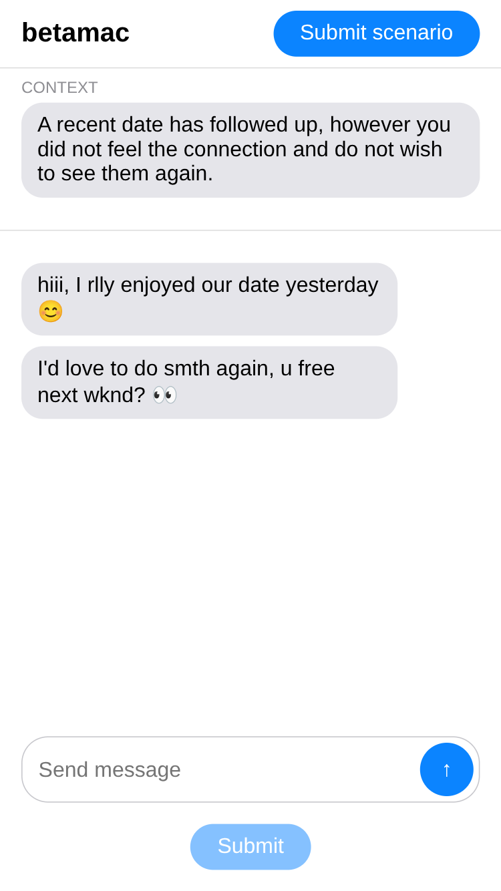

# betamac

Practise replying to tricky text messages. In a realistic chat, you type your reply and an AI marks it against what a good reply should do.

**Live at [betamac.app](https://betamac.app/)**. There's a growing set of scenarios, and anyone can submit their own, moderated automatically by AI.



## Built with

Python · Flask · Flask-Limiter · Gunicorn · nginx · vanilla JS/HTML/CSS · OpenRouter · TypeSafe Jev · DeepSeek

## How it works

Grading a reply:



Submitting a scenario:



- **Graded by probability, not an LLM's opinion.** Each criterion becomes a yes/no question for Jev, a decision model that returns a calibrated probability instead of generated text. The reply passes a criterion when that probability clears a threshold.
- **Automated moderation, also by Jev.** Nine yes/no checks in one call screen every submitted scenario, with no human in the loop.
- **DeepSeek writes the criteria.** It's called through the OpenRouter API with a strict prompt: 2–4 short verb phrases, no negatives, worded to fit the grader's exact question, with five existing scenarios as few-shot examples. Its output is parsed and validated before saving.
- **Thresholds tuned from labelled data.** Every moderation question has its own probability cutoff and direction (e.g. reject if "coherent" is below 0.55). An eval script checks the cutoffs against labelled pass/fail cases.
- **Every AI decision is logged.** Each Jev call is saved as a JSON line with its probabilities and outcome, ready for re-tuning.
- **Works well on desktop and phone.** On desktop the chat sits in a phone frame with the results beside it. On a phone the chat fills the screen and adapts when the keyboard opens.



## Why I built it

A friend told me they'd recently frozen up in a difficult text conversation, and it struck me that nobody practises this, even though it's how most of our hard conversations now happen: breakups, bad news, saying no. betamac gives you a low-stakes place to rehearse. The most interesting part was working with Jev, a non-chat decision model. Instead of trusting an LLM's verdict, I had to learn to treat its answers as calibrated probabilities and choose thresholds from labelled data, and that made fully automated moderation, with no human reviewing submissions, something I could actually reason about. Prompting two very different models was its own challenge: Jev needs precise yes/no criteria with examples, while DeepSeek needs a tightly constrained output format. The project also broadened my experience integrating and rate-limiting paid third-party APIs.

## Running locally

Prerequisites: Python 3.13 and an [OpenRouter](https://openrouter.ai/) API key.

```sh
python -m venv .venv
source .venv/bin/activate
pip install -r requirements.txt
```

Create a `.env` file in the repo root:

| Variable | Purpose |
| --- | --- |
| `OPENROUTER_JEV_API_KEY` | OpenRouter key for Jev (grading replies and moderating submitted scenarios) |
| `OPENROUTER_SCENE_CREATOR_API_KEY` | OpenRouter key for DeepSeek (writing criteria for submitted scenarios) |
| `SECRET_KEY` | Flask session secret (any long random string) |

Run it:

```sh
flask run                           # development, at http://127.0.0.1:5000
gunicorn "betamac:create_app()"     # production
```

Run the tests (no API calls are made):

```sh
python -m pytest -q tests
```

Check the moderation thresholds against labelled cases. This makes real, billed Jev calls, and the results go to `scripts/review_eval_runs/`:

```sh
python -m scripts.review_eval
```

## Acknowledgements

- [OpenRouter](https://openrouter.ai/), for API access to both models
- [TypeSafe](https://openrouter.ai/blog/insights/what-is-jev/), for Jev
- [DeepSeek](https://www.deepseek.com/)

## License

[MIT](LICENSE)
